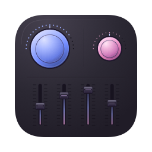
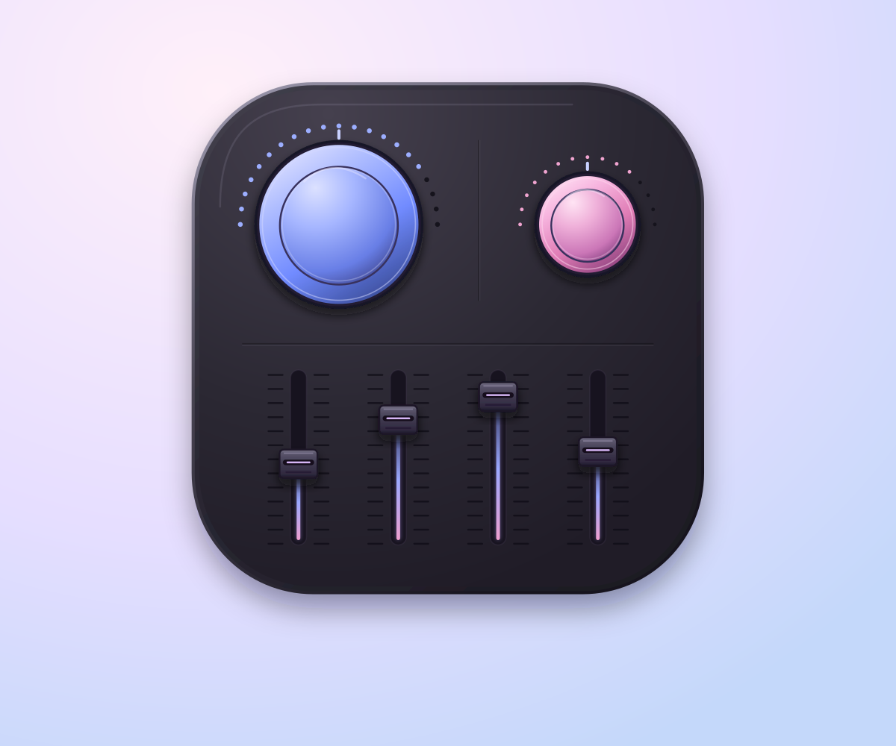

<p align="center">
  
</p>

# MacEQ

**System-wide parametric EQ for macOS, tailored to each output and each ear.**

MacEQ applies EQ to the output devices you enable, with side-by-side Left and Right editors, interactive frequency curves, and a live spectrum. Built in Rust using Core Audio process taps, with no audio driver to install.

<p align="center">
  
</p>

[Get started](#build-and-run) · [Using MacEQ](#using-maceq) · [Troubleshooting](#troubleshooting) · [Development](#development)

## Features

- **Enable EQ per device.** Each output has its own profile and enable switch. Disabled outputs receive no MacEQ tap, routing, format, or volume changes.
- **Independent Left and Right.** Adjust each channel separately, or use **Linked L + R** to edit both together.
- **Shape the sound directly.** Drag frequency points on either chart. Use up to 10 bands per channel, with bell, shelf, and pass filters.
- **See what is playing.** A live spectrum and output meters show the processed audio for the selected device.
- **Autosave and reconnect.** Profiles and device enablement persist across restarts. Enabled devices restore their settings when they reconnect with the same device UID.
- **Keep EQ in the menu bar.** Close the editor to hide the Dock icon while processing continues. Optional login startup opens only in the menu bar.

Audio stays on your Mac. MacEQ processes audio buffers in memory and does not save or transmit audio.

## Build and run

### Requirements

| Requirement | Version or support |
| --- | --- |
| macOS | 14.4 or later |
| Rust | 1.89 or later |
| Build tools | Xcode Command Line Tools |
| Output device | A supported stereo PCM output; see [compatibility](#compatibility-and-current-limits) |

The build targets your Mac's architecture. Apple Silicon has been checked; Intel builds and playback still need validation.

From the repository root:

```sh
cargo fetch --locked
./scripts/bundle.sh
open dist/MacEQ.app
```

The bundle script builds a release version, includes the icons and artwork, signs the app locally, and verifies its signature. Subsequent builds use the downloaded dependencies offline.

Use **MacEQ.app** for normal audio processing so macOS can associate its permission with the app. Before enabling **Open at login**, move the app to a stable location such as `/Applications`.

### First launch

1. In macOS Sound settings, select the output you want to use.
2. In MacEQ, choose that output under **Output device** and turn on **EQ enabled**.
3. Choose **Allow** when macOS requests system audio recording access.
4. Play audio, then adjust the Left and Right channels. Changes save automatically.

MacEQ keeps your existing system output selection. Choosing a device in the editor only selects the profile to edit; it does not enable that device or redirect audio to it.

### Audio permission

The macOS recording prompt is required to read the audio that MacEQ processes for EQ. The app does not record audio to disk.

Permission is normally remembered for the same build. Local builds use **ad-hoc signing**, so a rebuilt app can prompt again. Signing consistently with an Apple Development or Developer ID certificate gives macOS a stable app identity; see [signing](#signing-and-distribution).

You can review access in **System Settings → Privacy & Security → Screen & System Audio Recording**. The exact wording can vary with your macOS version.

## Using MacEQ

### Edit the EQ

Each channel has a response chart, preamp, output meter, and filter cards. The chart's left scale shows EQ gain in dB; the right scale shows spectrum level in dBFS. Spectrum data is measured after EQ and clip protection.

| Action | Control |
| --- | --- |
| Add a band | Click empty space on a chart, or choose **Add frequency band** |
| Change frequency and gain | Drag a band point horizontally and vertically |
| Change bandwidth (Q) | Hold **Shift** and drag a band point vertically |
| Reset a band's gain | Double-click its point |
| Enter an exact value | Double-click a numeric field and type; dragging also adjusts it |
| Adjust preamp | Drag the knob or edit its numeric value; double-click the knob to restore −6 dB |
| Reset a channel | Open its **•••** menu and choose **Reset channel** |
| Start with ten frequencies | Choose **Reset to 10 frequency bands** in the channel's **•••** menu |

Each band supports **Bell**, **Low shelf**, **High shelf**, **Low pass**, or **High pass**. Pass filters use frequency and Q; gain does not apply. The ten-frequency layout creates ten editable bell filters.

Choose **Independent** for separate Left and Right settings. Choosing **Linked L + R** copies the last edited channel to the other side, and subsequent edits affect both channels, including channel resets.

The default preamp is −6 dB to leave room for boosts. **Clip protection** applies a stereo-linked sample-peak limiter; it is not a true-peak limiter. **Hear original** lets you compare the dry audio while the device session stays running.

### Manage devices and presets

Open **Devices** to enable or disable connected and remembered outputs individually. Multiple enabled outputs have independent sessions. New devices default to disabled. Turning off EQ for one output stops only its session; other enabled outputs keep running.

Profiles are stored by the device's persistent UID rather than its display name. If an enabled output disconnects, MacEQ waits for that output to return and restores its profile. It does not substitute another device. A device that reports a different UID is treated as a different output.

Use **Preset library** to store extra versions of your sound. A preset includes both channels, preamps, channel linking, bypass, and clip protection. Storing an existing preset name replaces it; loading one applies it to the profile currently being edited.

### Menu bar and login startup

The grayscale menu-bar icon provides **Open MacEQ**, per-device EQ switches, **Open at login**, and **Quit MacEQ**.

| Action | Behavior |
| --- | --- |
| Close the editor | Hide the window, Dock icon, and app-switcher entry; keep EQ running |
| Choose **Open MacEQ** | Restore the editor and Dock icon |
| Enable **Settings → Open at login** | Register login startup with macOS; approval may be required in Login Items |
| Start at login | Restore enabled device sessions with only the menu-bar icon visible |
| Launch manually | Open the editor normally |
| Choose **Quit MacEQ** or press **Command-Q** | Stop all sessions and exit; remember which devices were enabled |

MacEQ must remain running to apply EQ. Closing its editor and quitting the app are separate actions.

### Autosave and memory

Edits save about 600 ms after you stop changing a value, and pending changes flush when switching devices, closing the editor, or quitting. The header shows **Saving…**, **Autosaved**, or **Save error**.

Settings live at:

```text
~/Library/Application Support/MacEQ/settings.json
```

Writes use a temporary file and rename. If settings cannot be read or validated, MacEQ preserves the original file and disables saving for that session.

In menu-bar mode, MacEQ releases large editor drawing surfaces and pauses chart construction and spectrum capture/analysis. EQ, autosave, and device reconnection continue. Minimizing also pauses chart updates and analysis. Reopening restores the editor's size and position.

A development check measured about **80 MiB** for the ordinary app in menu-bar mode after closing the editor. This is an observation, not a memory limit: usage varies with window size, display scale, enabled outputs, and macOS graphics caches. The open editor needs additional rendering memory.

## Compatibility and current limits

MacEQ is in early development. The current audio path requires:

- One output stream with two channels of native-endian 32-bit float PCM.
- Standard Left/Right speaker mapping.
- Interleaved or planar stereo buffers.

Multichannel interfaces, separate mono streams, encoded passthrough, and custom speaker mappings are not supported. Device enumeration and format checks do not establish successful playback on every device. Bluetooth profile changes, USB hot-plugging, sleep/wake, and simultaneous outputs still need broader hardware testing. Startup after an actual logout/login also needs end-to-end validation on the installed signed app.

## Troubleshooting

| Symptom | What to check |
| --- | --- |
| No EQ or a flat spectrum | Play audio through the selected macOS output, enable EQ for that device, check capture permission, and turn off **Hear original**. The spectrum runs only while the editor is visible and the selected device is processing. |
| **Waiting for device** | Confirm the saved output is connected and uses a supported format. MacEQ waits for its UID rather than switching to another output. |
| Permission appears after an update | This can happen with ad-hoc development builds. Grant access to the updated app; use stable signing for builds that should retain permission. |
| The editor disappeared | Choose **Open MacEQ** from the menu bar. Closing the window keeps the app running. |
| Login startup needs approval | Open Login Items settings from MacEQ and review its macOS registration. Use the signed app from a stable location. |
| Memory or the icon looks unchanged after rebuilding | Quit the running instance and reopen the newly built app. Rebuilding on disk does not replace the already running process. |
| **Save error** | Read the displayed error. If the existing settings file is invalid or from a newer version, quit, back it up, move it aside, and restart to create defaults. |

Read-only device diagnostics:

```sh
dist/MacEQ.app/Contents/MacOS/maceq --list-devices
```

This lists device identifiers, sample rates, and format support without starting capture or changing routing. Device names and UIDs can be identifying; redact them before sharing diagnostics publicly.

## Development

### Run checks

After fetching dependencies:

```sh
./scripts/check.sh
```

The script runs formatting, Clippy with warnings treated as errors, Rust tests, and native buffer/launch tests under address and undefined-behavior sanitizers. The current suite has 33 Rust tests covering DSP, callback routing, profile persistence, reconnection rules, chart interactions, and spectrum suspension/resumption.

Automated and synthetic tests do not replace listening tests, routing-isolation checks, permission testing, or hardware disconnect and recovery checks.

### Profile editor memory

```sh
cargo run --release --locked --offline --features memory-profile
# Start with the editor hidden:
cargo run --release --locked --offline --features memory-profile -- --background
```

This optional build uses a disposable profile, reads no user settings, and starts no audio taps. Over about 34 seconds it opens/hides the editor, prints macOS physical footprint, and checks window dimensions, visibility, and Dock activation policy. It measures UI overhead, not live audio processing. The normal app bundle excludes this feature.

### Architecture

For each enabled output, MacEQ creates a device-scoped private Core Audio tap and a private aggregate device containing the tap and hardware output. It processes captured audio and renders it back to the same output, without changing the system's default output. Taps exclude MacEQ itself. Disabled outputs are enumerated for display only.

| Component | Responsibility |
| --- | --- |
| [DSP](src/dsp.rs) | Biquads, independent channel state, parameter crossfades, finite-input protection, and limiting |
| [Rust audio bridge](src/audio.rs) / [Core Audio bridge](native/audio.m) | Device validation, tap/aggregate lifecycle, buffer routing, callback processing, and meters |
| [Spectrum](src/spectrum.rs) / [Charts](src/chart.rs) | Bounded sample queue, UI-thread FFT, response curves, and pointer editing |
| [Profiles](src/profile.rs) / [App state](src/main.rs) | Validated settings, atomic persistence, per-device sessions, and reconnection |
| [Rust platform bridge](src/platform.rs) / [macOS integration](native/platform.m) | Menu bar, window visibility, login startup, and background wakeups |
| [UI](src/ui.rs) / [Theme](src/theme.rs) | Side-by-side channel panels and studio-console controls |

The audio callback performs no locks, heap allocation, coefficient design, file access, or logging. Visualization queues drop display data when full rather than blocking playback. Device and format listeners invalidate sessions before rebuilding them; a watchdog retries stalled sessions. If native teardown fails, callback storage is retained and new session creation is blocked until quit to prevent use-after-free.

### Signing and distribution

Local builds use ad-hoc signing by default. To supply a stable signing identity:

```sh
MACEQ_SIGN_IDENTITY='Developer ID Application: Your Name (TEAMID)' ./scripts/bundle.sh
```

The script adds hardened runtime and a secure timestamp when an identity is supplied. Use your own bundle identifier in [Info.plist](bundle/Info.plist) for distribution. Public distribution also needs Developer ID signing, notarization, and stapling; the scripts do not submit notarization requests or bundle credentials.

### Artwork

Editable vector sources are in [assets](assets/README.md): [app icon](assets/AppIcon.svg), [presentation artwork](assets/Artwork.svg), and [grayscale menu-bar icon](assets/MenuBarTemplate.svg).

```sh
./scripts/icons.sh
```

This regenerates native PNG sizes and the ICNS using Swift/AppKit and `iconutil`. Bundling runs it automatically when sources change. Generated assets are included in the repository so a normal Rust compilation does not need to render them.

## References and license

Reference projects: [ParaEQ](https://github.com/wabsto1/ParaEQ) and [macos-parametric-eq](https://github.com/dylenq/macos-parametric-eq).

Apple documentation: [Core Audio taps](https://developer.apple.com/documentation/CoreAudio/capturing-system-audio-with-core-audio-taps), [SMAppService](https://developer.apple.com/documentation/servicemanagement/smappservice), and [NSStatusBar](https://developer.apple.com/documentation/appkit/nsstatusbar).

MacEQ is licensed under the **GNU General Public License v3.0 only**. See [LICENSE](LICENSE) for the full terms. Dependencies retain their respective licenses.
